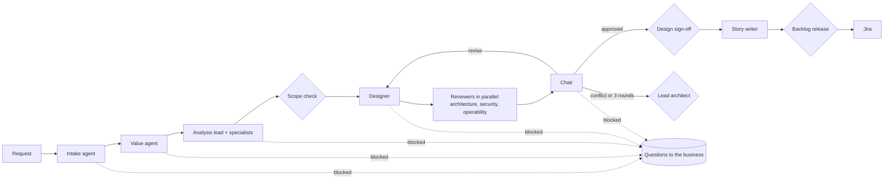
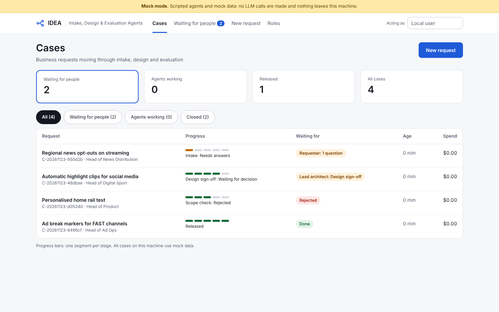
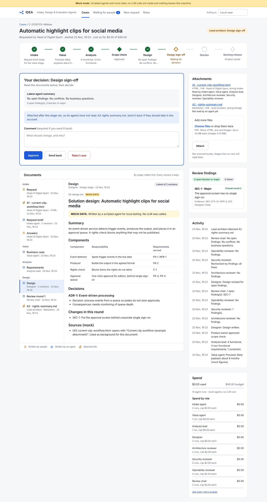
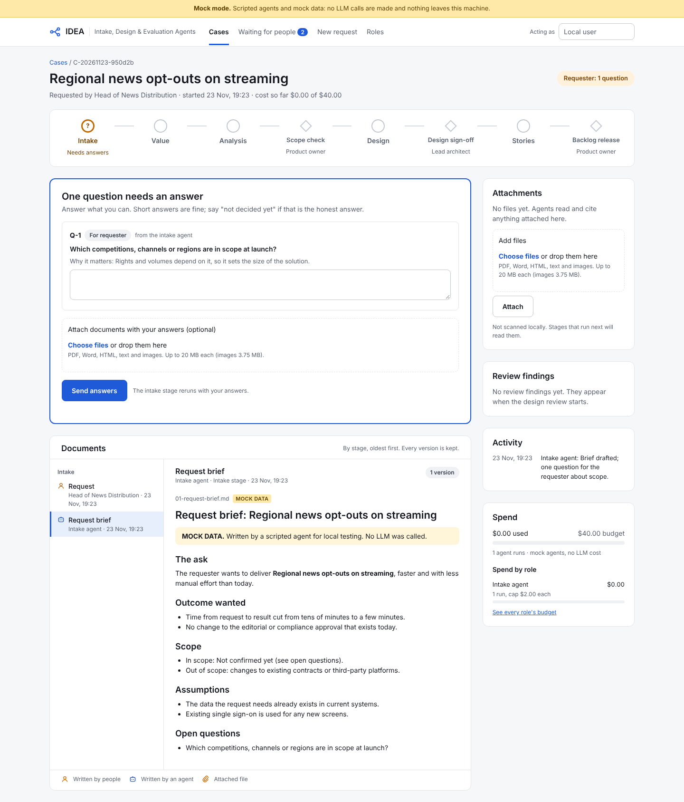
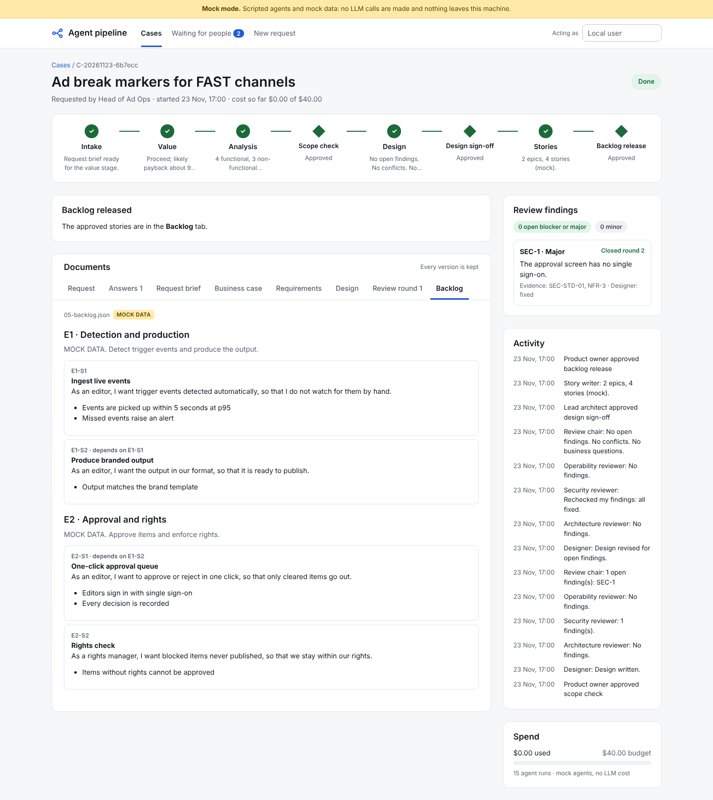
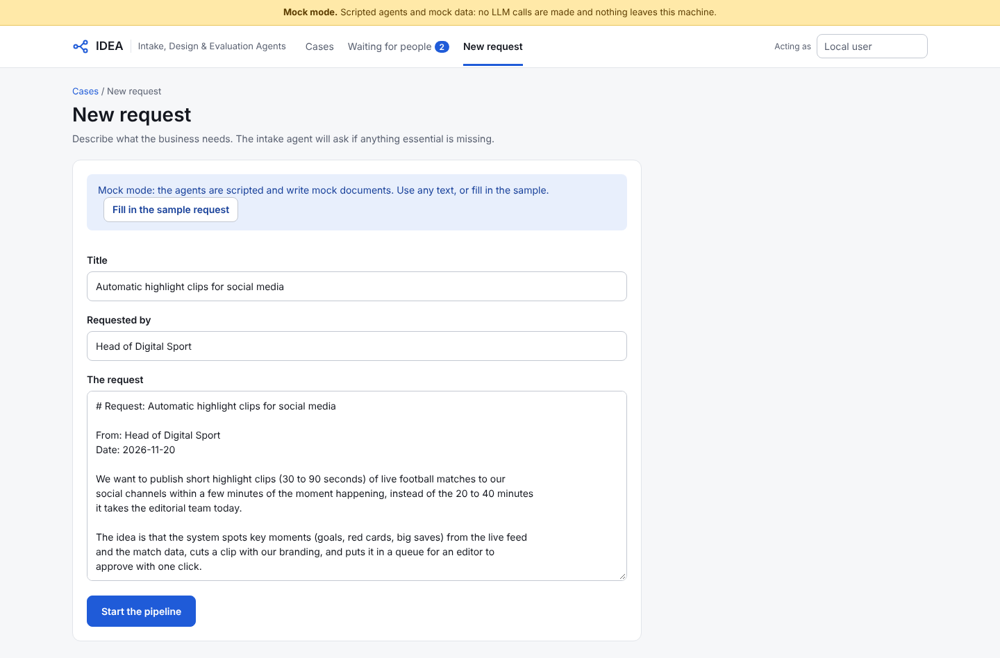
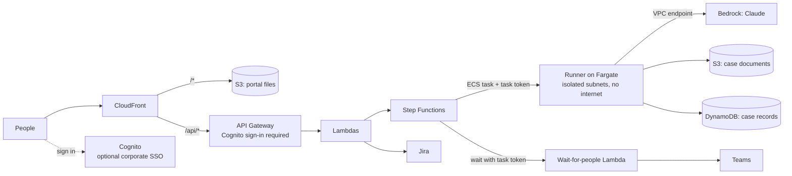
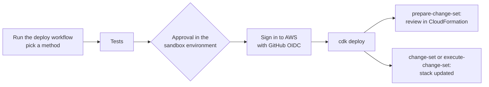

# multi-agent-cloud

A multi-agent pipeline that takes a business request ("we need to deliver this new product")
through clarification, value, analysis and a reviewed design, and ends with a backlog of stories
for delivery teams or build agents. It is the front half of an AI-assisted SDLC, with a web portal
where people answer the agents' questions and make the decisions.

Code owns the flow (stage order, gates, loop limits). Claude agents own the thinking inside each
stage. Agents hand over through documents in a case file, never through chat history, and people
stay in charge of every gate.



Diamonds are decisions people make. Any agent can return `blocked` with questions; the case then
waits, at no cost, until someone answers in the portal, and the same stage runs again with the answers.

## The portal

Screenshots from a local run on mock data (`python scripts/take_screenshots.py` regenerates them).

**Case list.** Every request, how far it has got, and who it is waiting for.



**A case at design sign-off.** The progress bar, the decision panel, the documents the agents wrote,
the review findings and the activity log.



**A case waiting for answers.** The intake agent's questions, who each is for and why it matters.



**A released case.** The backlog of epics and stories, ready for Jira.



**Starting a request.**



## What is in the repo

| Path | What it is |
| --- | --- |
| `catalogue/` | Everything that shapes the agents' work: role prompts, tool lists, models, output schemas, templates, standards, and `pipeline.yaml` (stages, gates, limits). Tune here; no code change needed. |
| `src/agentpipe/` | The Python package: stage runner, review rules, case store, local pipeline, CLI, the shared API views and the local portal server. |
| `src/agentpipe/aws/` | The AWS side: S3/DynamoDB case store, the ECS runner entrypoint, the Lambdas and the Step Functions generator. |
| `portal/` | The web portal: plain HTML, CSS and JavaScript, no build step. The same files run locally and on AWS. |
| `statemachine/pipeline.asl.json` | The generated state machine, for reading and review (a test keeps it in sync). |
| `infra/` | CDK app that deploys everything to AWS, and `github-deploy-role.yaml`, the CloudFormation template for the CI/CD deploy role. |
| `.github/workflows/` | `tests.yml` runs the tests on every push; `deploy.yml` deploys to AWS after an approval. |
| `scripts/take_screenshots.py` | Seeds mock cases and captures the portal screenshots above. |
| `examples/requests/` | A sample business request. |
| `tests/` | 66 tests; no Claude or AWS calls needed. |

## Run it locally (mock data, no LLM calls)

Needs Python 3.11 or later.

```bash
python -m venv .venv && source .venv/bin/activate
pip install -e ".[dev]"

agentpipe portal          # then open http://127.0.0.1:8080
```

**Locally, nothing calls an LLM.** The portal and the CLI use scripted agents that write mock
documents, so you can walk the whole pipeline (questions at intake, the gates, a review round that
finds and fixes an issue, the backlog) for free and offline. The portal shows a yellow
**Mock mode** banner on every page, every document carries a **MOCK DATA** label, and the
spend shows $0.00.

In the portal: **New request**, then **Fill in the sample request**, then **Start the pipeline**.
Answer the intake question, then approve or send back at each gate. Use **Acting as** in the top
right to record who is deciding.

The same flow from the command line:

```bash
agentpipe new examples/requests/highlights-clips.md
agentpipe answer <case-id> --text "Premier League and Champions League only" --by requester
agentpipe decide <case-id> approve --by "Product owner"    # scope check
agentpipe decide <case-id> approve --by "Lead architect"   # design sign-off
agentpipe decide <case-id> approve --by "Product owner"    # backlog release
agentpipe status <case-id>
```

Cases live in `./cases/<case-id>/`: documents in `docs/`, earlier versions in `history/`, and every
run, finding, question and decision in `records.json`.

**To tune the prompts against real Claude**, the CLI (not the portal) accepts an explicit `--live`
flag. It then uses an Anthropic API key (`ANTHROPIC_API_KEY`) or Bedrock
(`AGENTPIPE_USE_BEDROCK=1`, `AWS_REGION`, AWS credentials). Without `--live`, no LLM client is
even created; a test checks this.

## How a stage runs

1. The orchestrator (the local pipeline, or Step Functions on AWS) asks the **stage runner** to run
   one role for one case.
2. The runner builds a fresh working folder: `inputs/` with only the documents that role reads,
   `standards/`, `templates/` and an empty `output/`.
3. It runs the role with the Claude Agent SDK: the role's prompt, model, tool list, turn limit and
   spend cap. A hook stops the agent reading outside its folder or writing outside `output/`.
4. The agent writes its document and returns a JSON **envelope** (status, summary, blockers,
   findings, verdict). The runner checks it against `catalogue/schemas/envelope.schema.json` and the
   role's rules. If it fails, the agent gets one retry with the list of problems.
5. The runner saves the document and the records, and hands a small result back.

The design review: the designer writes, three reviewers check in parallel, each from one angle and
blind to the others' findings, and the chair merges duplicates and flags conflicts. Then **code**,
not an agent, decides the route (`src/agentpipe/review.py`):

| Situation | Route |
| --- | --- |
| The chair raised business questions | Wait for answers, then the designer revises |
| No open blocker or major findings | Design sign-off gate |
| Reviewers conflict, or 3 rounds used | Escalate to the lead architect |
| Otherwise | Next round |

## Configuration

`catalogue/pipeline.yaml`:

- **Gates**: `go_no_go` (after value) is off by default, so the first two stages run without
  approval. Switch any gate on or off with `enabled`.
- **Limits**: `max_review_rounds` (3), `case_budget_usd` (40) and `output_retries` (1).

Each role in `catalogue/roles/*.md` sets its `model`, `tools`, `max_turns`, `budget_usd`, the
documents it `reads` and `writes`, its `template` and the `standards` it applies.
**Replace the starter files in `catalogue/standards/` with your organisation's real standards**:
reviewers cite them as evidence, so the review is only as good as they are.

After changing `pipeline.yaml`, regenerate the state machine file and redeploy:

```bash
python -m agentpipe.aws.asl > statemachine/pipeline.asl.json
```

## Deploy to AWS

### What gets deployed



| Part | AWS resources | Notes |
| --- | --- | --- |
| Portal | S3 bucket (private) + CloudFront | Files read through Origin Access Control; HTTPS only; managed security headers |
| Sign-in | Cognito user pool, hosted sign-in page, app client | Self sign-up off; authorization code flow with PKCE; optional SAML federation with your identity provider |
| API | API Gateway REST API under `/api`, behind CloudFront | Every method requires a Cognito token; throttled; access logs |
| Orchestration | Step Functions (Standard) | Generated from `pipeline.yaml`; waits up to 30 days for people at no cost |
| Agent runner | ECS Fargate task definition and cluster, image built from `Dockerfile` | One task per agent run; isolated subnets with no internet route |
| Network | VPC (2 AZs, isolated subnets), gateway endpoints for S3 and DynamoDB, interface endpoints for ECR, ECR Docker, CloudWatch Logs, Bedrock Runtime and Step Functions | Every AWS service the runner calls has an endpoint |
| Case file | S3 bucket (versioned) + DynamoDB table (point-in-time recovery) | Both kept if the stack is deleted |
| Lambdas | Start case, list cases, get case, respond, wait for people, publish backlog, finish case | Python 3.12; only boto3 needed |
| Secrets | Teams webhook, Jira credentials (Secrets Manager) | Created empty; features stay off until filled |
| Model access | IAM policy on the runner role | `bedrock:InvokeModel*` on Anthropic models and inference profiles only |

### Before you start

- [ ] An AWS account for the sandbox, and credentials that can deploy CloudFormation, IAM, VPC,
      ECS, Lambda, Step Functions, Cognito, CloudFront, S3, DynamoDB and Secrets Manager.
- [ ] **Claude enabled in Amazon Bedrock** in that account and region. Anthropic models need a
      one-time use case form in the Bedrock console. In `eu-west-2` (London) you will most likely use
      the EU cross-region inference profiles: note the **model IDs** of the Opus and Sonnet profiles
      you want (Bedrock console, Cross-region inference).
- [ ] AWS CLI v2, Node.js 18 or later, the CDK CLI (`npm install -g aws-cdk`), Python 3.11 or later.
- [ ] **Docker running.** The deploy builds the runner image for `linux/amd64` (on Apple silicon
      this uses emulation: slower, but it works).

### Ways to deploy

The stack is written with the AWS CDK, which **generates a CloudFormation template and deploys it as a
CloudFormation stack** named `AgentPipeline`. You can see and audit everything in the CloudFormation
console like any other stack. There are three ways to run the deployment:

| Option | Best for | How |
| --- | --- | --- |
| [A. From your machine](#option-a-deploy-from-your-machine) | First deploy, experiments | `cdk deploy` from a laptop |
| [B. CloudFormation change set](#option-b-review-a-cloudformation-change-set-first) | Changes someone must review before they happen | `cdk deploy --method=prepare-change-set`, review in the CloudFormation console, then execute |
| [C. CI/CD pipeline](#option-c-cicd-with-github-actions) | Repeatable, approved deploys with no AWS keys on laptops | The `deploy` GitHub Actions workflow, using OIDC and a GitHub environment approval |

All three need the one-time CDK bootstrap (step 2 below) and the checklist above.

### Option A: deploy from your machine

1. **Install the CDK app's dependencies**

   ```bash
   cd infra
   python -m venv .venv && source .venv/bin/activate
   pip install -r requirements.txt
   ```

2. **Bootstrap CDK** (once per account and region)

   ```bash
   cdk bootstrap aws://<ACCOUNT_ID>/eu-west-2
   ```

3. **Deploy**, giving the Bedrock model IDs from the checklist

   ```bash
   cdk deploy \
     -c account=<ACCOUNT_ID> -c region=eu-west-2 \
     -c opusModel=<Opus inference profile ID> \
     -c sonnetModel=<Sonnet inference profile ID>
   ```

   On Bedrock, Claude Code's `opus` and `sonnet` aliases point to older models unless
   `ANTHROPIC_DEFAULT_OPUS_MODEL` and `ANTHROPIC_DEFAULT_SONNET_MODEL` are set; `opusModel` and
   `sonnetModel` set them on the runner. Optional context values:

   | Context | Use |
   | --- | --- |
   | `authDomainPrefix` | Prefix of the sign-in page address (default `agent-pipeline-<account id>`) |
   | `samlMetadataUrl`, `samlProviderName` | Sign in with your corporate identity provider (step 5) |
   | `haikuModel` | Model ID for Claude Code's small background tasks |

   The first deploy takes a while, mostly building the image and creating CloudFront. When it
   finishes, note the outputs: `PortalUrl`, `UserPoolId`, `SignInDomain`, `StateMachineArn`,
   `CaseBucket`, `CaseTable`, `TeamsWebhookSecret`, `JiraSecret`.

4. **Create the first users** (Cognito emails each a temporary password)

   ```bash
   aws cognito-idp admin-create-user --user-pool-id <UserPoolId> \
     --username you@company.com \
     --user-attributes Name=email,Value=you@company.com Name=email_verified,Value=true Name="name",Value="Your Name"
   ```

5. **Optional: sign in with corporate SSO (SAML).** In your identity provider (for example Entra ID),
   create an enterprise application with:
   - Identifier (entity ID): `urn:amazon:cognito:sp:<UserPoolId>`
   - Reply URL: `<SignInDomain>/saml2/idpresponse`
   - Claims: email address and name

   Then redeploy with `-c samlMetadataUrl=<the app's federation metadata URL> -c samlProviderName=CorporateSSO`.
   The sign-in page then offers the SSO button.

6. **Optional: Teams and Jira.** Until these are set, notifications are only logged and Jira
   publishing runs as a dry run (it records what it would create).

   ```bash
   aws secretsmanager put-secret-value --secret-id <TeamsWebhookSecret> \
     --secret-string '{"url": "<Teams incoming webhook URL>"}'
   aws secretsmanager put-secret-value --secret-id <JiraSecret> \
     --secret-string '{"base_url": "https://<site>.atlassian.net", "email": "...", "api_token": "...", "project_key": "ABC"}'
   ```

7. **Smoke test.** Open `PortalUrl`, sign in and set your password. Choose **New request** and paste
   `examples/requests/highlights-clips.md`. Each case is a Step Functions execution named after the
   case id, so you can follow it in the Step Functions console; the runner's logs are in CloudWatch
   under the `runner` stream prefix. Expect the intake agent to ask a question within a few minutes;
   answer it in the portal and carry on through the gates.

### Option B: review a CloudFormation change set first

Use this when a change to the sandbox (or later, production) must be reviewed before it is applied.

1. **See the generated CloudFormation template** (optional, no AWS changes):

   ```bash
   cd infra
   cdk synth -c account=<ACCOUNT_ID> -c region=eu-west-2 > AgentPipeline.template.yaml
   ```

   The template is what CloudFormation will run. It refers to assets (the runner image, the Lambda
   code and the portal files) that `cdk deploy` uploads to the CDK bootstrap bucket and ECR repository,
   which is why the next step uses `cdk deploy` rather than uploading the template by hand.

2. **Create a change set without applying it:**

   ```bash
   cdk deploy -c account=<ACCOUNT_ID> -c region=eu-west-2 \
     -c opusModel=<Opus model ID> -c sonnetModel=<Sonnet model ID> \
     --method=prepare-change-set --change-set-name agent-pipeline-release
   ```

   This uploads the assets and creates the change set **agent-pipeline-release** on the
   `AgentPipeline` stack. Nothing is changed yet. For a first deploy, the stack shows as
   `REVIEW_IN_PROGRESS` until the change set is executed.

3. **Review it**: CloudFormation console, stack `AgentPipeline`, **Change sets** tab. It lists every
   resource that will be added, changed or replaced, including IAM changes.

4. **Apply it**, either with **Execute change set** in the console, or:

   ```bash
   cdk deploy -c account=<ACCOUNT_ID> -c region=eu-west-2 \
     -c opusModel=<Opus model ID> -c sonnetModel=<Sonnet model ID> \
     --method=execute-change-set --change-set-name agent-pipeline-release
   ```

   (`execute-change-set` needs a recent CDK CLI; on an older one, use the console or
   `aws cloudformation execute-change-set --stack-name AgentPipeline --change-set-name agent-pipeline-release`.)

Then carry on from step 4 of option A (users, SSO, secrets, smoke test).

### Option C: CI/CD with GitHub Actions

The repo includes `.github/workflows/deploy.yml`. Each run tests the code, waits for an approver,
then deploys from GitHub to AWS. GitHub signs in to AWS with **OpenID Connect**, so no AWS keys are
stored anywhere.



**One-time setup**

1. **Bootstrap CDK** in the account (option A, step 2). This needs an administrator once; after that
   the pipeline only uses the roles bootstrap created.

2. **Create the deploy role** from the CloudFormation template in this repo. It trusts only workflow
   jobs from this repository running in the `sandbox` GitHub environment, and it can do nothing
   except assume the CDK bootstrap roles:

   ```bash
   aws cloudformation deploy --stack-name agent-pipeline-github-deploy \
     --template-file infra/github-deploy-role.yaml --capabilities CAPABILITY_NAMED_IAM \
     --region eu-west-2 \
     --parameter-overrides GitHubOwner=garghe RepositoryName=multi-agent-cloud GitHubEnvironment=sandbox
   aws cloudformation describe-stacks --stack-name agent-pipeline-github-deploy --region eu-west-2 \
     --query "Stacks[0].Outputs[?OutputKey=='DeployRoleArn'].OutputValue" --output text
   ```

   If the account already has the GitHub OIDC identity provider, add `CreateOidcProvider=false`.

3. **Create the GitHub environment**: repository Settings, Environments, **New environment** named
   `sandbox`. Under **Required reviewers** add the people who approve deploys.

4. **Add environment variables** to `sandbox` (Settings, Environments, sandbox, Environment variables).
   None of these are secrets:

   | Variable | Value |
   | --- | --- |
   | `AWS_DEPLOY_ROLE_ARN` | The `DeployRoleArn` output from step 2 |
   | `AWS_ACCOUNT_ID` | The AWS account ID |
   | `AWS_REGION` | `eu-west-2` |
   | `OPUS_MODEL`, `SONNET_MODEL` | The Bedrock model or inference profile IDs |
   | `HAIKU_MODEL`, `AUTH_DOMAIN_PREFIX`, `SAML_METADATA_URL` | Optional, as in option A |

**Each deploy**

1. Actions tab, **deploy**, **Run workflow**, choose a method:
   - `prepare-change-set` (default): creates the change set for review, changes nothing.
   - `execute-change-set`: applies the change set from the previous prepare run.
   - `change-set`: creates and applies in one go.
2. The tests run, then the deploy job waits for a required reviewer to approve.
3. After approval it deploys. The run summary shows the stack outputs, or where to review the
   change set.

The first run still needs steps 4 to 7 of option A afterwards (users, SSO, secrets, smoke test).

**Other CI/CD tools.** The same pattern works elsewhere: AWS CodePipeline (for example with CDK
Pipelines), GitLab CI or Azure DevOps. Run the tests, then `cdk deploy` with the same `-c` values and
`--method`, from a role that can only assume the CDK bootstrap roles, signed in with the tool's own
OIDC support rather than stored keys.

### Update and remove

- **Update** after changing code, prompts or `pipeline.yaml`: run the same `cdk deploy` command, or the
  deploy workflow.
  Prompts and standards are baked into the runner image, so every catalogue change is a deploy.
- **Remove**: `cdk destroy`. The case documents bucket, the records table and the user pool are kept
  on purpose, so no case history is lost; delete them by hand if you really want them gone.

### Running costs

Most of the cost is Claude tokens, capped per run (`budget_usd` per role) and per case
(`case_budget_usd`). Everything else is pay per use, except the **interface VPC endpoints**: five
endpoints in two availability zones are billed by the hour even when nothing runs. Cognito,
CloudFront, API Gateway, Lambda, Step Functions and DynamoDB cost little at this volume.

### Troubleshooting

| Symptom | Likely cause |
| --- | --- |
| Runner task stops with `CannotPullContainerError` | The image could not be pulled through the ECR endpoints; check the endpoints exist and the task runs in the stack's isolated subnets |
| Runner log shows `AccessDenied` or `ValidationException` from Bedrock | Claude not enabled in the account, or the model ID is not available in the region |
| Runner hangs, then times out | It tried to reach a service without an endpoint (the runner has no internet). Add the interface endpoint for that service in `infra/pipeline_stack.py` |
| Case stays on "Agents working" | Open the Step Functions execution named after the case; a failed agent run ends in the `Failed` state with the error |
| Sign-in loops back to the sign-in page | The browser blocks session storage, or the app client callback URL was changed by hand; it must be `PortalUrl` + `/` |

### What has been checked, and what only a real deploy can check

Checked in this repo:

- The stack synthesises, and `cfn-lint` finds no errors in the CloudFormation template (a test runs it).
- The generated state machine passes `cfn-lint`'s Step Functions schema checks (a test runs it), and a
  structural test confirms every state is reachable and every transition target exists.
- The CI/CD deploy role template passes `cfn-lint`, and a test checks it trusts only this repository's
  `sandbox` environment and can do nothing but assume the CDK bootstrap roles.
- Every Lambda handler imports with only Python and boto3, as in the Lambda runtime.
- The runner package installs in a clean environment with the Claude Code CLI that the Agent SDK bundles.
- Design checks, each covered by a test or visible in the stack: no NAT or internet gateway, every
  service the runner calls has an endpoint, both buckets block public access, every API method requires
  sign-in, the workflow's task token never reaches the browser, and only the first of two simultaneous
  responses to a case is accepted.

Only a first deploy in the sandbox can confirm:

- the Docker image build (no Docker daemon was available where this was written);
- Claude access and the model IDs in your region;
- the Claude Code CLI running inside Fargate with no internet route;
- the Cognito sign-in round trip, SAML federation, Teams and Jira.

## API

The portal uses this API; it is the same locally (`agentpipe portal`) and on AWS, where each call
needs the signed-in user's Cognito ID token in the `Authorization` header.

| Method and path | Body | Returns |
| --- | --- | --- |
| `GET /api/cases` | | Cases with progress, who they wait for and spend, plus counts |
| `POST /api/cases` | `{"title", "request", "requester"}` | `{"case_id"}` |
| `GET /api/cases/{id}` | | The case page: progress, questions, findings, activity, cost |
| `GET /api/cases/{id}?doc=04-design.md` | | One document |
| `POST /api/cases/{id}/respond` | `{"answers"}` or `{"outcome": "approve" \| "send_back" \| "reject", "comment"}` | `{"outcome"}` |

On AWS the person acting is always taken from the sign-in token, never from the request body.

## Tests

```bash
pip install -e ".[dev]" "moto[s3,dynamodb]" cfn-lint -r infra/requirements.txt
pytest
```

66 tests cover the catalogue, the envelope and backlog rules, the path guard, the review routing,
full pipeline runs (blockers, review rounds, conflicts, escalation, rejection, budget stop), the API
views, the local portal server end to end, mock-by-default local runs, the state machine, the runner
entrypoint, the Lambdas, the S3/DynamoDB store (with moto), the CDK stack (synth plus `cfn-lint`), and the CI/CD deploy role and workflow.
Tests that need moto, CDK or `cfn-lint` skip when those are not installed.

## Status and next steps

Built and tested without calling Claude or deploying to AWS. Before relying on it:

1. Run the CLI with `--live` on 3 past requests where you know the right answer, and tune the prompts
   in `catalogue/roles/`.
2. Replace `catalogue/standards/` with the real standards packs.
3. Deploy to the sandbox account and run one request end to end (the smoke test above).

Not built yet: who-may-approve rules (today any signed-in user can answer or decide, and every action
is recorded with their name), reminders and escalation timers for slow answers (a case waits up to
30 days, then stops), Teams approval cards, a cost dashboard, and reading standards from Confluence.
