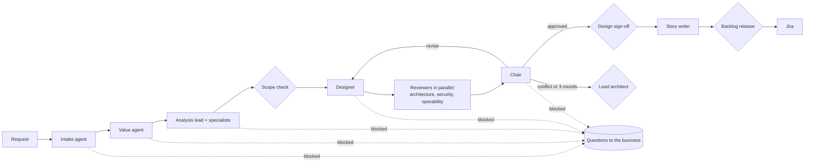
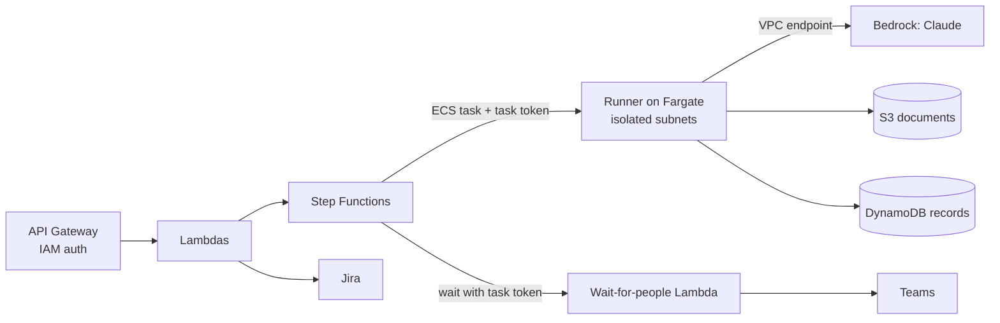

# multi-agent-cloud

A multi-agent pipeline that takes a business request ("we need to deliver this new product")
through clarification, value, analysis and a reviewed design, and ends with a backlog of stories
for delivery teams or build agents. It is the front half of an AI-assisted SDLC.

Code owns the flow (stage order, gates, loop limits). Claude agents own the thinking inside each
stage. Agents hand over through documents in a case file, never through chat history, and people
stay in charge of every gate.



Diamonds are decisions people make. Any agent can return `blocked` with questions; the case then
waits, at no cost, until someone answers, and the same stage runs again with the answers.

## What is in the repo

| Path | What it is |
| --- | --- |
| `catalogue/` | Everything that shapes the agents' work: role prompts, tool lists, models, output schemas, templates, standards, and `pipeline.yaml` (stages, gates, limits). Tune here; no code change needed. |
| `src/agentpipe/` | The Python package: the stage runner, the review rules, the case store and the local pipeline. |
| `src/agentpipe/aws/` | The AWS MVP: S3/DynamoDB case store, the ECS runner entrypoint, the Lambdas and the Step Functions generator. |
| `statemachine/pipeline.asl.json` | The generated state machine, for reading and review (a test keeps it in sync). |
| `infra/` | CDK app that deploys the AWS MVP. |
| `examples/requests/` | A sample business request. |
| `tests/` | 51 tests; no Claude or AWS calls needed. |

## Quick start: the local prototype

Needs Python 3.11 or later.

```bash
python -m venv .venv && source .venv/bin/activate
pip install -e ".[dev]"

# Dry run with scripted agents: no API calls, no cost. Shows every path of the flow.
agentpipe --fake new examples/requests/highlights-clips.md
agentpipe --fake answer <case-id> --text "Premier League and Champions League only" --by requester
agentpipe --fake decide <case-id> approve --by "Product owner"    # scope check
agentpipe --fake decide <case-id> approve --by "Lead architect"   # design sign-off
agentpipe --fake decide <case-id> approve --by "Product owner"    # backlog release
agentpipe status <case-id>
```

To run with Claude, drop `--fake` and give the Agent SDK credentials, either an Anthropic API key
(`export ANTHROPIC_API_KEY=...`) or Bedrock (`export AGENTPIPE_USE_BEDROCK=1 AWS_REGION=eu-west-2`,
with AWS credentials that can call Bedrock). Each case lives in `./cases/<case-id>/`: the documents
in `docs/`, earlier versions in `history/`, and every run, finding, question and decision in
`records.json`.

Useful flags: `--keep-workspaces` keeps each agent's working folder for debugging; `-v` shows logs.

## How a stage runs

1. The orchestrator (the local pipeline, or Step Functions on AWS) asks the **stage runner** to run
   one role for one case.
2. The runner builds a fresh working folder: `inputs/` with only the documents that role reads,
   `standards/`, `templates/` and an empty `output/`.
3. It runs the role with the Claude Agent SDK: the role's prompt, model, tool list, turn limit and
   spend cap. A hook stops the agent reading outside its folder or writing outside `output/`.
4. The agent writes its document and returns a JSON **envelope** (status, summary, blockers,
   findings, verdict). The runner checks it against `catalogue/schemas/envelope.schema.json` and
   the role's rules. If it fails, the agent gets one retry with the list of problems.
5. The runner saves the document and the records, and hands a small result back.

The design review works the same way: the designer writes, three reviewers check in parallel,
each from one angle and blind to the others' findings, and the chair merges duplicates and flags
conflicts. Then **code**, not an agent, decides the route (`src/agentpipe/review.py`):

| Situation | Route |
| --- | --- |
| The chair raised business questions | Wait for answers, then the designer revises |
| No open blocker or major findings | Design sign-off gate |
| Reviewers conflict, or 3 rounds used | Escalate to the lead architect |
| Otherwise | Next round |

From round 2 each reviewer rechecks only its own open findings and may add only new blockers, so
the goalposts do not move. The designer must answer every open finding: fixed, rejected with a
reason, or needs business input.

## Configuration

`catalogue/pipeline.yaml`:

- **Gates**: `go_no_go` (after value) is off by default, so the first two stages run without
  approval. Switch any gate on or off with `enabled`.
- **Limits**: `max_review_rounds` (3), `case_budget_usd` (40) and `output_retries` (1).

Each role in `catalogue/roles/*.md` sets its `model`, `tools`, `max_turns`, `budget_usd`, the
documents it `reads` and `writes`, its `template` and the `standards` it applies.
**Replace the starter files in `catalogue/standards/` with your organisation's real standards**:
reviewers cite them as evidence, so the quality of the review depends on them.

After changing `pipeline.yaml`, regenerate the state machine file:

```bash
python -m agentpipe.aws.asl > statemachine/pipeline.asl.json
```

## The AWS MVP



- Every agent run is one ECS Fargate task that reports back to Step Functions with a task token.
- Waiting for people is a Lambda that stores a task token and posts to Teams. The respond API
  resumes the workflow. Nothing runs while a case waits, for up to 30 days.
- The runner has no internet route. It reaches Bedrock, S3, DynamoDB, ECR, logs and Step Functions
  through VPC endpoints.
- S3 versioning keeps every version of every document. DynamoDB has point-in-time recovery.

### Deploy

Needs the AWS CDK CLI, Docker, and Bedrock model access for Claude in the target account.

```bash
cd infra
pip install -r requirements.txt
cdk bootstrap                         # once per account and region
cdk deploy -c account=<id> -c region=eu-west-2 \
  -c opusModel=<Bedrock Opus model or inference profile id> \
  -c sonnetModel=<Bedrock Sonnet model or inference profile id>
```

On Bedrock, Claude Code's `opus` and `sonnet` aliases point to older models unless
`ANTHROPIC_DEFAULT_OPUS_MODEL` and `ANTHROPIC_DEFAULT_SONNET_MODEL` are set; the `opusModel` and
`sonnetModel` context values set them on the runner. Check which models and inference profiles are
enabled in your region first.

After deploying, fill the two secrets the stack creates (their names are in the stack outputs):

- Teams: `{"url": "<incoming webhook URL>"}`
- Jira: `{"base_url": "https://<site>.atlassian.net", "email": "...", "api_token": "...", "project_key": "ABC"}`

Until they are filled in, notifications are only logged and Jira publishing runs as a dry run.

### Use the API

All calls are signed with IAM (for example with `awscurl`).

```bash
# start a case
awscurl --service execute-api -X POST "$API/cases" \
  -d '{"title": "Highlight clips", "request": "...", "requester": "Head of Digital Sport"}'

# see where it is, the open questions and findings, the documents and cost so far
awscurl --service execute-api "$API/cases/<case-id>"
awscurl --service execute-api "$API/cases/<case-id>?doc=04-design.md"

# answer questions, or decide a gate or escalation
awscurl --service execute-api -X POST "$API/cases/<case-id>/respond" -d '{"answers": "Premier League only"}'
awscurl --service execute-api -X POST "$API/cases/<case-id>/respond" -d '{"outcome": "approve", "comment": "OK"}'
awscurl --service execute-api -X POST "$API/cases/<case-id>/respond" \
  -d '{"outcome": "send_back", "comment": "Reuse the existing SSO proxy"}'
```

## Tests

```bash
pip install -e ".[dev]" moto aws-cdk-lib constructs   # moto and CDK are optional; their tests skip without them
pytest
```

The tests cover the catalogue, the envelope and backlog rules, the path guard, the review routing,
full pipeline runs with scripted agents (blockers, review rounds, conflicts, escalation, rejection,
budget stop), the generated state machine's structure, the runner entrypoint, the Lambdas, the
S3/DynamoDB store (with moto) and a CDK synth.

## Status and next steps

Built and tested without calling Claude or deploying to AWS. Before the first real run:

1. Run the prototype with Claude on 3 past requests where you know the right answer, and tune the
   prompts in `catalogue/roles/`.
2. Replace `catalogue/standards/` with the real standards packs.
3. Deploy to the sandbox account and run one request end to end.

Not built yet: reminders and escalation timers for slow answers (today a case waits up to 30 days,
then stops), a review portal UI (the API is the portal for now), a cost dashboard, and reading
standards from Confluence instead of the catalogue.
